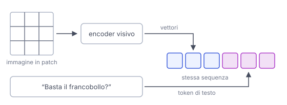

# IT

## In una frase

Un modello multimodale lavora con più tipi di dati insieme, come testo, immagini e audio, e li collega tra loro.

## Approfondimento

Un modello **multimodale** riceve, e a volte produce, più tipi di dati. Il trucco è tradurre tutto nello stesso linguaggio interno: vettori di numeri. In molti modelli, un'immagine viene divisa in piccoli riquadri (patch). Un encoder visivo trasforma i riquadri in vettori, proiettati nello stesso spazio degli embedding delle parole. Da lì il modello tratta pezzi di immagine e token di testo nella stessa sequenza. Per l'audio vale un principio simile.

Così può descrivere una foto, leggere un appunto scritto a mano o rispondere a una domanda su uno screenshot. In uscita, molti modelli generano solo testo. Per creare immagini o voce alcuni modelli aggiungono componenti dedicati.

Limiti: i dettagli fini restano difficili. Contare oggetti, leggere scritte minuscole o capire posizioni precise può fallire. E le immagini consumano molti token, quindi spazio nel contesto e costo.

## Nella vita di tutti i giorni

Al bancone della posta mostri una busta e chiedi: «Basta questo francobollo?». L'impiegato la guarda, legge l'indirizzo, ne stima il peso a occhio e ti risponde. Non serve che tu gli descriva la busta a parole: unisce in un colpo solo quello che vede e la tua domanda. Un modello multimodale fa lo stesso con una foto e un testo.

## Errore comune

Errore comune: credere che il modello trasformi sempre prima l'immagine in una didascalia e poi ragioni solo sul testo. In molti modelli multimodali i pezzi d'immagine diventano vettori elaborati direttamente insieme alle parole. Passare da una didascalia si può, ma si perde informazione.

## Didascalia della figura

I riquadri dell'immagine diventano vettori e finiscono nella stessa sequenza dei token di testo, che il modello elabora insieme.

# EN

## One line

A multimodal model handles several kinds of data together, such as text, images and audio, and connects them to each other.

## Deep dive

A **multimodal** model takes in, and sometimes produces, several types of data. The trick is translating everything into one internal language: vectors of numbers. In many models, an image is cut into small squares (patches). A vision encoder turns the patches into vectors, projected into the same space as the word embeddings. From there the model handles image pieces and text tokens in a single sequence. Audio works on a similar principle.

That is how it can describe a photo, read a handwritten note or answer a question about a screenshot. On the output side, many models generate only text. Some models add dedicated components to produce images or speech.

Limits: fine detail remains hard. Counting objects, reading tiny print or judging exact positions can fail. And images use up many tokens, which costs context space and money.

## In everyday life

At the post office counter you hold up an envelope and ask: “Is this stamp enough?” The clerk looks at it, reads the address, judges the weight by eye and answers. You don't need to describe the envelope in words: they combine what they see with your question in one go. A multimodal model does the same with a photo and a line of text.

## Common mistake

Common mistake: believing the model always turns the image into a caption first and then reasons only about text. In many multimodal models, image patches become vectors processed directly alongside the words. Going through a caption is possible, but it loses information.

## Figure caption

Image patches become vectors and join the same sequence as the text tokens, which the model processes together.

# Sources

## yin-multimodal-llm-survey
- Work: [A Survey on Multimodal Large Language Models](https://arxiv.org/abs/2306.13549v4)
- Author: Yin et al.
- Year: 2023
- Language: en
- Note.it: Panoramica dei modelli multimodali: encoder, connettore verso il modello linguistico e generatore facoltativo per l'output (sezione 2, figura 2). Tecnico.
- Note.en: An overview of multimodal models: the encoder, the connector to the language model and an optional generator for output (section 2, figure 2). Technical.

