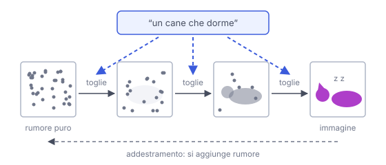

# IT

## In una frase

Un modello di diffusione crea immagini partendo da puro rumore e togliendolo un passo alla volta, eventualmente guidato da una descrizione testuale.

## Approfondimento

In addestramento si prendono immagini vere e si aggiunge rumore casuale a piccoli passi, fino a ottenere solo puntini a caso. Il modello impara il compito inverso: data un'immagine rumorosa, stimare il rumore da togliere. Per generare, si parte da rumore puro e si ripete questo passaggio molte volte. A ogni giro emerge un po' più di struttura: prima forme vaghe, poi dettagli.

Nei sistemi guidati dal testo, il prompt entra tramite un encoder di testo che orienta ogni passaggio verso ciò che è descritto. Molti sistemi lavorano in uno spazio compresso (**latent diffusion**) invece che sui pixel, per risparmiare calcolo. Lo stesso principio si usa anche per audio e video.

Il compromesso: servono molti passaggi, quindi la generazione può essere lenta, anche se esistono tecniche per ridurli. E il controllo fine può restare difficile: testo leggibile dentro l'immagine, numero esatto di oggetti, disposizioni precise.

## Nella vita di tutti i giorni

Uno scultore guarda un blocco di marmo grezzo e toglie un po' di pietra, poi un altro po'. All'inizio si intuisce solo una sagoma, poi una testa, infine i dettagli del pelo. Il cliente gli ha chiesto «un cane che dorme», e ogni colpo di scalpello va in quella direzione. Un modello di diffusione fa lo stesso, ma il suo marmo è rumore casuale.

## Errore comune

Errore comune: pensare che il modello incolli pezzi di immagini viste in addestramento. Genera dal rumore usando schemi statistici appresi. Detto questo, a volte può riprodurre quasi identiche immagini molto presenti nei suoi dati.

## Didascalia della figura

Si parte da rumore puro e lo si toglie passo dopo passo, guidati dal prompt: è il compito che il modello ha imparato in addestramento, togliendo il rumore aggiunto a immagini vere.

# EN

## One line

A diffusion model creates images by starting from pure noise and removing it step by step, optionally guided by a text description.

## Deep dive

During training, real images get random noise added in small steps until only static remains. The model learns the reverse job: given a noisy image, estimate the noise to remove. To generate, you start from pure noise and repeat that step many times. Each round brings out a little more structure: vague shapes first, then details.

In text-guided systems, the prompt comes in through a text encoder that steers every step toward what is described. Many systems work in a compressed space (**latent diffusion**) rather than on raw pixels, to save compute. The same principle is also used for audio and video.

The trade-off: many steps are needed, so generation can be slow, although there are techniques to cut them down. And fine control can remain hard: legible text inside the image, an exact number of objects, precise layouts.

## In everyday life

A sculptor faces a rough block of marble and chips some stone away, then a little more. At first only an outline shows, then a head, finally the texture of the fur. The client asked for “a sleeping dog”, and every stroke of the chisel moves that way. A diffusion model does the same, except its marble is random noise.

## Common mistake

Common mistake: thinking the model pastes together pieces of training images. It generates from noise using learned statistical patterns. That said, it can sometimes reproduce near-copies of images that appear very often in its data.

## Figure caption

Generation starts from pure noise and removes it step by step, guided by the prompt: the skill the model learned in training by removing noise added to real images.

# Sources

## ddpm-ho
- Work: [Denoising Diffusion Probabilistic Models](https://arxiv.org/abs/2006.11239v2)
- Author: Ho et al.
- Year: 2020
- Language: en
- Note.it: Generare immagini imparando a togliere il rumore aggiunto ai dati (sezione 2, algoritmi 1 e 2). La figura 6 mostra prima le forme grandi, poi i dettagli. Tecnico.
- Note.en: Generating images by learning to remove noise added to data (section 2, algorithms 1 and 2). Figure 6 shows large shapes first, then details. Technical.

## latent-diffusion-rombach
- Work: [High-Resolution Image Synthesis with Latent Diffusion Models](https://arxiv.org/abs/2112.10752v2)
- Author: Rombach et al.
- Year: 2021
- Language: en
- Note.it: La diffusione in uno spazio compresso per risparmiare calcolo (abstract e sezione 3) e un encoder di testo che guida la generazione (sezione 3.3). Tecnico.
- Note.en: Diffusion in a compressed space to save compute (abstract and section 3) and a text encoder that steers generation (section 3.3). Technical.
