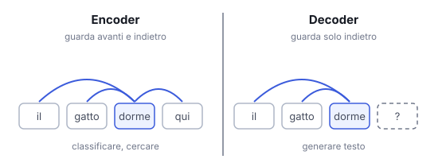

# IT

## In una frase

Encoder e decoder sono due modi di usare il transformer: uno legge tutto il testo insieme, l'altro scrive un token dopo l'altro.

## Approfondimento

Il transformer originale (2017, nato per la traduzione) aveva due metà. L'**encoder** legge la frase intera, e ogni parola può guardare tutte le altre, prima e dopo. Ne esce una rappresentazione ricca del significato. Il decoder genera l'uscita un token alla volta e può guardare solo i token già scritti, più il lavoro dell'encoder.

Da lì sono nate tre famiglie. Solo encoder (come BERT): ottimi per classificare testi e creare embedding per la ricerca. Encoder-decoder: adatti a trasformare un testo in un altro, come tradurre o riassumere. Solo decoder: la base di molti grandi modelli linguistici di oggi. Prevedere il token successivo è un compito generale, e questi modelli migliorano con la scala.

Il compromesso: un encoder vede il contesto in entrambe le direzioni ma non è fatto per generare testo. Un decoder scrive bene ma, a parità di dimensioni, può rendere meno di un encoder su compiti che beneficiano del contesto in entrambe le direzioni, come la classificazione.

## Nella vita di tutti i giorni

In una redazione lavorano due persone. Il correttore legge l'articolo intero, avanti e indietro, e capisce di cosa parla: sa dirti l'argomento o trovare l'errore. Lo scrittore invece compone riga dopo riga, e per scegliere la parola successiva guarda solo ciò che ha già scritto. Quando lavorano insieme a una traduzione, uno legge l'originale e l'altro scrive la versione nuova.

## Errore comune

Errore comune: credere che i modelli solo decoder sappiano generare ma non capire. La differenza sta in quali token ogni posizione può guardare: i grandi decoder se la cavano bene su molti compiti di comprensione, come rispondere a domande su un testo.

## Didascalia della figura

Nell'encoder ogni token guarda l'intera sequenza, mentre nel decoder guarda solo i token già scritti, compreso se stesso.

# EN

## One line

Encoders and decoders are two ways of using the transformer: one reads the whole text at once, the other writes one token after another.

## Deep dive

The original transformer (2017, built for translation) had two halves. The **encoder** reads the whole sentence, and every word can look at all the others, before and after. The result is a rich representation of meaning. The decoder generates the output one token at a time and can only look at tokens already written, plus the encoder's work.

Three families grew from that. Encoder-only (such as BERT): great for classifying text and producing embeddings for search. Encoder-decoder: suited to turning one text into another, like translating or summarizing. Decoder-only: the basis of many of today's large language models. Predicting the next token is a general task, and these models improve with scale.

The trade-off: an encoder sees context in both directions but is not built to generate text. A decoder writes well but, at the same size, can do worse than an encoder on tasks that benefit from context in both directions, such as classification.

## In everyday life

Two people work at a newspaper. The proofreader reads the whole article, back and forth, and grasps what it is about: they can name the topic or spot the error. The writer composes line by line and, to choose the next word, looks only at what is already written. When they work together on a translation, one reads the original and the other writes the new version.

## Common mistake

Common mistake: believing decoder-only models can generate but not understand. The difference lies in which tokens each position can look at: large decoders do well on many comprehension tasks, such as answering questions about a text.

## Figure caption

In an encoder every token looks at the whole sequence, while in a decoder it looks only at tokens already written, itself included.

# Sources

## slp3-jurafsky-martin
- Work: [Speech and Language Processing, 3rd edition draft](https://web.stanford.edu/~jurafsky/slp3/)
- Author: Daniel Jurafsky and James H. Martin
- Year: 2026
- Language: en
- Note.it: Manuale universitario gratuito: le tre architetture, encoder, decoder ed encoder-decoder, nella sezione 9.1 (bozza di agosto 2026). In parte tecnico.
- Note.en: Free university textbook: the three architectures, encoder, decoder and encoder-decoder, in section 9.1 (August 2026 draft). Partly technical.

## transformer-vaswani
- Work: [Attention Is All You Need](https://arxiv.org/abs/1706.03762v7)
- Author: Vaswani et al.
- Year: 2017
- Language: en
- Note.it: Il paper originale del transformer: encoder e decoder nella sezione 3, con la maschera che impedisce al decoder di guardare i token successivi (sezione 3.2.3). Tecnico.
- Note.en: The original transformer paper: encoder and decoder in section 3, with the mask that stops the decoder from looking at later tokens (section 3.2.3). Technical.
