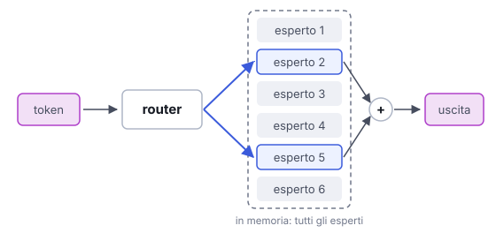

# IT

## In una frase

Un modello Mixture of Experts contiene molte sotto-reti, gli esperti, e per ogni token ne attiva solo poche, scelte da un router.

## Approfondimento

In un transformer classico ogni token passa per tutti i parametri. In un modello **Mixture of Experts** (MoE), in alcuni o in tutti gli strati, una parte della rete è divisa in tanti blocchi, gli esperti. Un piccolo componente, il router, guarda ogni token e sceglie i pochi esperti più adatti, una piccola frazione del totale. Gli altri restano fermi per quel token.

Il vantaggio: il modello può avere moltissimi parametri in totale, quindi molta capacità, ma usarne solo una parte per ogni token. Così il calcolo per parola resta vicino a quello di un modello molto più piccolo.

Il compromesso: tutti gli esperti devono comunque stare in memoria, quindi serve hardware con molta memoria. L'addestramento è più delicato: bisogna evitare che il router mandi tutto agli stessi pochi esperti. E distribuire gli esperti su più chip aumenta il traffico di dati tra loro.

## Nella vita di tutti i giorni

Nella cucina di un grande ristorante ci sono venti cuochi, ma ogni comanda passa solo da due o tre postazioni. Lo chef smista: questa va alla griglia e ai contorni, quella al forno. La brigata sa fare moltissimo, ma ogni piatto impegna poche persone, così la cucina regge tanti ordini. Lo stipendio però va pagato a tutti e venti, anche a chi in quel momento è fermo.

## Errore comune

Errore comune: immaginare ogni esperto come lo specialista di una materia, uno per la medicina, uno per la cucina. Il router sceglie token per token: in alcuni modelli non emerge una chiara specializzazione per argomento, ma si osservano schemi legati ai tipi di token, come la punteggiatura.

## Didascalia della figura

Il router manda ogni token solo a pochi esperti e ne combina i risultati, ma tutti gli esperti restano in memoria.

# EN

## One line

A Mixture of Experts model contains many sub-networks, the experts, and activates only a few of them for each token, picked by a router.

## Deep dive

In a classic transformer every token goes through all the parameters. In a **Mixture of Experts** (MoE) model, part of some or all layers is split into many blocks, the experts. A small component, the router, looks at each token and picks the few best-suited experts, a small fraction of the total. The rest stay idle for that token.

The benefit: the model can have a huge number of parameters in total, so a lot of capacity, while using only part of them for each token. Compute per word stays close to that of a much smaller model.

The trade-off: all the experts still have to sit in memory, so you need hardware with plenty of it. Training is trickier: you have to stop the router from sending everything to the same few experts. And spreading experts across several chips adds data traffic between them.

## In everyday life

A big restaurant kitchen has twenty cooks, but each order passes through only two or three stations. The chef routes them: this one to the grill and sides, that one to the oven. The brigade can do a great deal, yet each dish ties up only a few people, so the kitchen keeps up with many orders. Wages, though, go to all twenty, including whoever is standing idle right now.

## Common mistake

Common mistake: picturing each expert as a subject specialist, one for medicine, one for cooking. The router chooses token by token: some models show no clear specialization by topic, but do show patterns related to token types, such as punctuation.

## Figure caption

The router sends each token to only a few experts and combines their results, but all experts still stay in memory.

# Sources

## shazeer-sparsely-gated-moe
- Work: [Outrageously Large Neural Networks: The Sparsely-Gated Mixture-of-Experts Layer](https://arxiv.org/abs/1701.06538v1)
- Author: Shazeer et al.
- Year: 2017
- Language: en
- Note.it: Un lavoro fondamentale sulle reti con esperti attivati solo in parte: router, capacità molto più grande e, nella sezione 4, il rischio di usare sempre gli stessi esperti. Tecnico.
- Note.en: A foundational paper on sparsely activated expert networks: the router, much larger capacity and, in section 4, the risk of always using the same experts. Technical.

## mixtral-of-experts
- Work: [Mixtral of Experts](https://arxiv.org/abs/2401.04088v1)
- Author: Jiang et al., Mistral AI
- Year: 2024
- Language: en
- Note.it: Un modello recente: il router sceglie 2 esperti su 8 per ogni token (sezione 2). In questo modello la sezione 5 non trova schemi evidenti per argomento. Tecnico.
- Note.en: A recent model: the router picks 2 of 8 experts for each token (section 2). In this model, section 5 finds no obvious patterns by topic. Technical.
