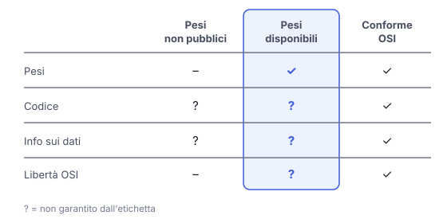

# IT

## In una frase

Un modello a pesi aperti si può scaricare ed eseguire da sé, ma non è per forza open source, né libero da condizioni.

## Approfondimento

I **pesi** sono i numeri imparati durante l'addestramento. Quando vengono pubblicati, chi ha l'hardware adatto può eseguire il modello sui propri computer o adattarlo con il fine-tuning. Ma pesi aperti non vuol dire per forza open source. La definizione dell'Open Source Initiative (OSI, 2024) richiede anche il codice per addestrare ed eseguire il modello, informazioni dettagliate sui dati e la libertà di usare, studiare, modificare e condividere il sistema. Un rilascio può dare i pesi senza il resto, con una licenza che pone condizioni d'uso.

I possibili vantaggi includono ricerca indipendente, meno concentrazione del mercato e l'uso del modello senza mandare dati a terzi. Ma una pubblicazione non si può ritirare: le copie già scaricate restano.

Alcune protezioni apprese si possono indebolire modificando i pesi: gli studi lo mostrano con un breve fine-tuning o con modifiche mirate, nei modelli esaminati. Il rilascio dei pesi riduce il controllo del fornitore sulle modifiche successive. Separatamente, nei forum criminali si vendono strumenti chiamati "uncensored": un'analisi del 2025 ne attribuisce due a modelli esistenti guidati da prompt modificati, senza escludere il fine-tuning.

## Nella vita di tutti i giorni

Un ristorante regala a chi lo chiede un barattolo della sua salsa. A casa puoi usarla e aggiungerci quello che vuoi. Ma non hai la ricetta, non sai da dove vengono gli ingredienti, e sull'etichetta ci sono delle condizioni. E una volta distribuiti, i barattoli non tornano indietro: chiunque può cambiarne il contenuto, anche togliendo quello che il cuoco aveva messo apposta.

## Errore comune

Si pensa che pesi aperti significhi open source, gratis e privato. Aperto riguarda cosa viene pubblicato e a quali condizioni. La privacy dipende da dove esegui il modello, e l'hardware per farlo ha un costo.

## Didascalia della figura

La disponibilità dei pesi non garantisce codice per addestrare ed eseguire, informazioni sui dati e libertà di uso, studio, modifica e condivisione richiesti dalla definizione OSI.

# EN

## One line

An open-weight model can be downloaded and run on your own, but it is not necessarily open source, or free of conditions.

## Deep dive

The **weights** are the numbers learned during training. Once they are published, anyone with suitable hardware can run the model on their own computers or adapt it with fine-tuning. But open weights do not necessarily mean open source. The Open Source Initiative's definition (OSI, 2024) also requires the code to train and run the model, detailed information about the data, and the freedom to use, study, modify and share the system. A release can give the weights without the rest, under a licence that sets conditions of use.

Potential benefits include independent research, less market concentration, and use of the model without sending data to third parties. But a release cannot be taken back: copies already downloaded stay out there.

Some learned safeguards can be weakened by changing the weights: studies show this with brief fine-tuning or targeted edits, in the models examined. Releasing the weights reduces the provider's control over subsequent modifications. Separately, criminal forums sell tools called "uncensored": a 2025 analysis attributes two of them to existing models steered by modified prompts, without ruling out fine-tuning.

## In everyday life

A restaurant gives a jar of its sauce to anyone who asks. At home you can use it and add whatever you like. But you do not get the recipe, you do not know where the ingredients came from, and the label sets some conditions. And once the jars are handed out, they do not come back: anyone can change what is inside, even removing what the cook put there on purpose.

## Common mistake

People assume open weights means open source, free and private. Open is about what gets published and on what terms. Privacy depends on where you run the model, and the hardware to run it has a cost.

## Figure caption

Available weights do not guarantee the training and inference code, data information, and freedoms to use, study, modify and share required by the OSI definition.

# Sources

## osi-open-source-ai-definition
- Work: [The Open Source AI Definition 1.0](https://opensource.org/ai/open-source-ai-definition)
- Author: Open Source Initiative
- Year: 2024
- Language: en
- Note.it: La definizione citata nella lezione: le quattro libertà e cosa va pubblicato oltre ai pesi, cioè il codice per addestrare ed eseguire e le informazioni sui dati.
- Note.en: The definition cited in the lesson: the four freedoms and what must be published besides the weights, meaning code to train and run and data information.

## ntia-open-weights-report
- Work: [Dual-Use Foundation Models with Widely Available Model Weights](https://www.ntia.gov/sites/default/files/publications/ntia-ai-open-model-report.pdf)
- Author: NTIA, US Department of Commerce
- Year: 2024
- Language: en
- Note.it: Rapporto pubblico sui pesi aperti: i vantaggi nella sintesi iniziale, le protezioni rimovibili e il rilascio che non si ritira nel Background, pagina 8.
- Note.en: Public report on open weights: the benefits in the executive summary, removable safeguards and why a release cannot be withdrawn in the Background, page 8.
