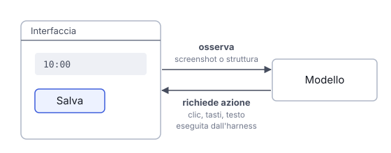

# IT

## In una frase

Un agente che usa il computer lavora su interfacce fatte per le persone: osserva cosa mostrano, clicca o scrive, poi guarda cosa è cambiato.

## Approfondimento

Molti siti e programmi non offrono uno strumento pensato per un agente. Allora l'agente usa l'interfaccia come farebbe una persona. Il ciclo è quello già visto: l'harness mostra al modello lo stato attuale, il modello chiede un'azione (un clic, un tasto, del testo), l'harness la esegue e restituisce gli esiti e le nuove osservazioni disponibili. Lo stato può essere uno **screenshot**, cioè un'immagine dello schermo, oppure una descrizione strutturata della pagina che elenca pulsanti e campi con il loro nome.

Il punto difficile è collegare l'intenzione all'elemento giusto: individuare il pulsante o il campo corretto. Il modello può sbagliare elemento o coordinate, e ogni giro richiede tempo. Uno strumento diretto, quando esiste, può evitare i passaggi dell'interfaccia.

Lo stato mostrato può contenere istruzioni ingannevoli (prompt injection), e le azioni usano gli accessi della sessione. Per questo si consiglia un ambiente separato con pochi privilegi, niente password o dati sensibili a portata di mano, e una conferma umana prima delle azioni con conseguenze rilevanti.

## Nella vita di tutti i giorni

Una nonna sposta un appuntamento sul calendario del computer, con il nipote al telefono. Lui non tocca nulla: chiede cosa vede sullo schermo, dice dove cliccare, aspetta e chiede di nuovo. Alla fine non si fida di «ho premuto Salva»: le fa riaprire l'appuntamento per controllare che l'orario sia cambiato davvero. È lento, perché ogni passaggio va descritto e controllato. Il nipote è il modello. Le mani della nonna sono l'harness.

## Errore comune

Si pensa che un agente di questo tipo veda e capisca lo schermo come una persona. Lavora per osservazioni separate, può sbagliare elemento, e deve verificare gli effetti con nuove osservazioni o altri riscontri.

## Didascalia della figura

Il modello riceve osservazioni dell'interfaccia, come screenshot o struttura della pagina, e richiede azioni che l'harness esegue prima di restituirne gli esiti.

# EN

## One line

A computer-use agent works on interfaces built for people: it observes what they show, clicks or types, then checks what changed.

## Deep dive

Many websites and programs offer no tool built for agents. So the agent uses the interface the way a person would. The loop is the familiar one: the harness shows the model the current state, the model asks for an action (a click, a key press, some text), the harness carries it out and returns the results and any new observations available. The state can be a **screenshot**, an image of the screen, or a structured description of the page that lists buttons and fields by name.

The hard part is linking the intention to the right element: identifying the correct button or field. The model can pick the wrong element or the wrong coordinates, and every round takes time. A direct tool, when one exists, can avoid the interface steps.

The displayed state may contain deceptive instructions (prompt injection), and actions use the session's access. Hence the advice: a separate environment with few privileges, no passwords or sensitive data within reach, and human confirmation before actions with meaningful consequences.

## In everyday life

A grandmother moves an appointment in her computer calendar, with her grandson on the phone. He touches nothing: he asks what she sees on the screen, tells her where to click, waits and asks again. At the end he does not trust "I pressed Save": he has her reopen the appointment to check the time really changed. It is slow, because every step has to be described and checked. The grandson is the model. Her hands are the harness.

## Common mistake

People think this kind of agent sees and understands the screen like a person. It works through separate observations, can pick the wrong element, and must check the effects through new observations or other evidence.

## Figure caption

The model receives observations of the interface, as a screenshot or the page's structure, and requests actions that the harness executes before returning their results.

# Sources

## computer-use-tool
- Work: [Computer use tool](https://platform.claude.com/docs/en/agents-and-tools/tool-use/computer-use-tool)
- Author: Anthropic
- Year: undated
- Language: en
- Note.it: La documentazione di Claude: il modello chiede screenshot, clic e tasti, l'applicazione li esegue e restituisce il risultato. Tratta anche le istruzioni nascoste nelle pagine (sezioni "How computer use works" e "Security considerations").
- Note.en: Claude's docs: the model asks for screenshots, clicks and keystrokes, the application runs them and returns the result. It also covers instructions hidden in pages (sections "How computer use works" and "Security considerations").
