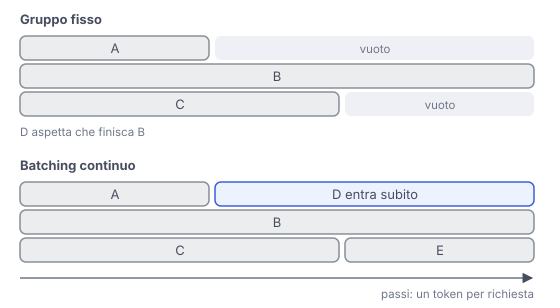

# IT

## In una frase

Con il batching continuo una sola GPU serve molte richieste insieme: a ogni token generato, chi ha finito esce e chi aspetta entra.

## Approfondimento

Quando scrive, il modello produce un token alla volta, e per ogni token deve rileggere i suoi pesi, miliardi di numeri, dalla memoria della GPU. Con una sola richiesta il collo di bottiglia è questa lettura, e gran parte della capacità di calcolo resta inutilizzata. Il **batching** mette insieme più richieste: i pesi letti una volta servono a tutte, e a ogni passo esce un token per ciascuna.

Le richieste però arrivano in momenti diversi e hanno risposte di lunghezza diversa. In un gruppo fisso, chi finisce presto lascia un posto vuoto finché non termina la risposta più lunga, e chi arriva deve aspettare il gruppo successivo. Il **batching continuo** ricompone il gruppo a ogni passo: chi ha finito esce e chi aspetta entra subito.

Il limite è la memoria: ogni richiesta ha la sua KV cache, e lo spazio sulla GPU decide quante ne entrano insieme (vedi KV cache). C'è anche un compromesso. Più richieste insieme abbassano il costo di ognuna, ma quando il server è molto carico ogni utente aspetta di più.

## Nella vita di tutti i giorni

Un pullman turistico parte quando è pieno e torna solo quando tutti hanno finito il giro. Un autobus di linea invece non aspetta: a ogni fermata scende chi è arrivato e sale chi aspettava. Così un solo mezzo porta molte persone, ognuna fino alla sua fermata, senza lasciare posti vuoti per lunghi tratti. Ma nell'ora di punta, con l'autobus pieno e la coda alle fermate, tutti arrivano un po' più tardi.

## Errore comune

Si pensa che la velocità di un modello sia fissa, una sua caratteristica come le dimensioni. In realtà lo stesso modello, sullo stesso server, risponde più lentamente quando molti utenti lo usano insieme: conta anche il carico del momento.

## Didascalia della figura

Con un gruppo fisso i posti liberati restano vuoti fino alla fine, con il batching continuo una nuova richiesta entra al passo successivo.

# EN

## One line

With continuous batching one GPU serves many requests at once: at every generated token, finished requests leave and waiting ones join.

## Deep dive

When it writes, a model produces one token at a time, and for each token it must read its weights, billions of numbers, from GPU memory again. With a single request this reading is the bottleneck, and much of the computing power sits idle. **Batching** groups several requests: weights read once serve all of them, and each step yields one token for each request.

Requests, however, arrive at different times and need answers of different lengths. In a fixed batch, a request that finishes early leaves an empty slot until the longest answer ends, and a new arrival must wait for the next batch. **Continuous batching** rebuilds the batch at every step: finished requests leave and waiting ones join at once.

The limit is memory: each request has its own KV cache, and the space on the GPU decides how many fit together (see KV Cache). There is also a trade-off. More requests together lower the cost of each one, but when the server is very busy every user waits longer.

## In everyday life

A tour coach leaves when it is full and comes back only when everyone has finished the trip. A city bus does not wait: at every stop, those who have arrived get off and those who were waiting get on. One vehicle carries many people, each to their own stop, without leaving seats empty for long stretches. But at rush hour, with the bus full and queues at the stops, everyone arrives a little later.

## Common mistake

People often think a model's speed is fixed, a property like its size. In fact the same model, on the same server, answers more slowly when many users are using it at once: the load of the moment matters too.

## Figure caption

With a fixed batch, freed slots stay empty until the end, while with continuous batching a new request joins at the next step.

# Sources

## orca
- Work: [Orca: A Distributed Serving System for Transformer-Based Generative Models](https://www.usenix.org/conference/osdi22/presentation/yu)
- Author: Yu et al.
- Year: 2022
- Language: en
- Note.it: Il paper che ha proposto di ricomporre il gruppo a ogni passo, con il nome di iteration-level scheduling: oggi è noto come batching continuo (sezione 3). Tecnico.
- Note.en: The paper that proposed rebuilding the batch at every step, under the name iteration-level scheduling: today it is known as continuous batching (section 3). Technical.
