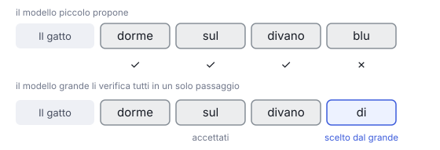

# IT

## In una frase

Un modello piccolo propone qualche token e il grande li controlla in un passaggio: si scrive più in fretta, come se scrivesse solo il grande.

## Approfondimento

Un modello grande scrive un token alla volta, rileggendo a ogni passo i suoi pesi dalla memoria (vedi Batching continuo). Controllarne alcuni insieme richiede invece circa lo stesso tempo che generarne uno, perché i pesi si leggono una volta sola. La **decodifica speculativa** sfrutta questa differenza: un modello piccolo e veloce propone i prossimi token, per esempio quattro, e il modello grande li verifica tutti insieme.

Il grande accetta i token proposti finché sono compatibili con le sue probabilità, sostituisce il primo scartato con uno suo e riparte da lì. Ogni passaggio produce quindi almeno un token, anche quando la bozza sbaglia subito. Una regola di accettazione probabilistica garantisce che il testo segua esattamente le probabilità del grande. Nei paper originali, con una richiesta alla volta, la generazione era circa due o tre volte più veloce.

Il guadagno dipende da quanto spesso la bozza indovina, e quindi dal tipo di testo. Il calcolo totale aumenta, perché i token scartati sono lavoro sprecato. Su un server molto carico la GPU ha poca capacità libera, e il metodo può persino rallentare.

## Nella vita di tutti i giorni

Il completamento automatico del telefono propone le prossime parole. Se sono proprio quelle che volevi scrivere, le accetti con un tocco e fai prima. Se la seconda è sbagliata, tieni la prima e scrivi tu la parola giusta. Il messaggio resta tuo: il suggerimento serve solo ad andare più veloce. Nella decodifica speculativa il modello piccolo è il suggerimento, e il modello grande decide, come fai tu.

## Errore comune

Si pensa che sia uno scambio tra velocità e qualità, perché a scrivere è un modello piccolo. In realtà ogni token passa al vaglio del modello grande, e il risultato segue le sue stesse probabilità. Il prezzo è altrove: più calcolo e, su un server carico, a volte meno velocità.

## Didascalia della figura

Il modello piccolo propone quattro token, il grande li verifica in un solo passaggio, ne accetta tre e sostituisce il quarto con il suo.

# EN

## One line

A small model drafts a few tokens and the large one checks them in one pass: faster writing, as if the large model wrote alone.

## Deep dive

A large model writes one token at a time, rereading its weights from memory each step (see Continuous batching). Checking several tokens together, though, takes about as long as generating one, because the weights are read only once. **Speculative decoding** exploits this gap: a small, fast model drafts the next few tokens, say four, and the large model verifies them all together.

The large model accepts drafted tokens as long as they fit its probabilities, replaces the first rejected one with its own, and resumes from there. Each pass thus yields at least one token, even if the first guess is wrong. A probabilistic acceptance rule guarantees that the text follows the large model's probabilities exactly. In the original papers, with one request at a time, generation was about two to three times faster.

The gain depends on how often the draft guesses right, which varies with the kind of text. Total computation goes up, because rejected tokens are wasted work. On a very busy server the GPU has little spare capacity, and the method can even slow things down.

## In everyday life

Your phone's autocomplete suggests the next words. If they are exactly what you meant to type, you accept them with one tap and finish sooner. If the second word is wrong, you keep the first and type the right word yourself. The message is still yours: the suggestion only makes you faster. In speculative decoding the small model is the suggestion, and the large model decides, as you do.

## Common mistake

People often think it trades quality for speed, because a small model does the writing. In fact every token is vetted by the large model, and the result follows its own probabilities. The cost lies elsewhere: more computation and, on a busy server, sometimes less speed.

## Figure caption

The small model drafts four tokens, the large one checks them in a single pass, keeps three and replaces the fourth with its own.

# Sources

## speculative-decoding
- Work: [Fast Inference from Transformers via Speculative Decoding](https://arxiv.org/abs/2211.17192v1)
- Author: Leviathan et al., Google Research
- Year: 2022
- Language: en
- Note.it: Il paper che ha introdotto il metodo: bozza, verifica in parallelo e regola che conserva le probabilità del modello grande (sezione 2), poi i tempi misurati (sezione 4). Tecnico.
- Note.en: The paper that introduced the method: draft, parallel check and the rule that preserves the large model's probabilities (section 2), then the measured times (section 4). Technical.

## speculative-sampling
- Work: [Accelerating Large Language Model Decoding with Speculative Sampling](https://arxiv.org/abs/2302.01318v1)
- Author: Chen et al., DeepMind
- Year: 2023
- Language: en
- Note.it: Lo stesso metodo, sviluppato in modo indipendente: perché verificare pochi token richiede circa lo stesso tempo che generarne uno (introduzione) e come il guadagno cambia con il tipo di testo. Tecnico.
- Note.en: The same method, developed independently: why checking a few tokens takes about as long as generating one (introduction) and how the gain changes with the kind of text. Technical.
